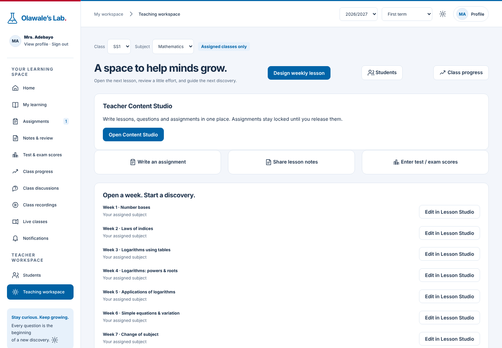
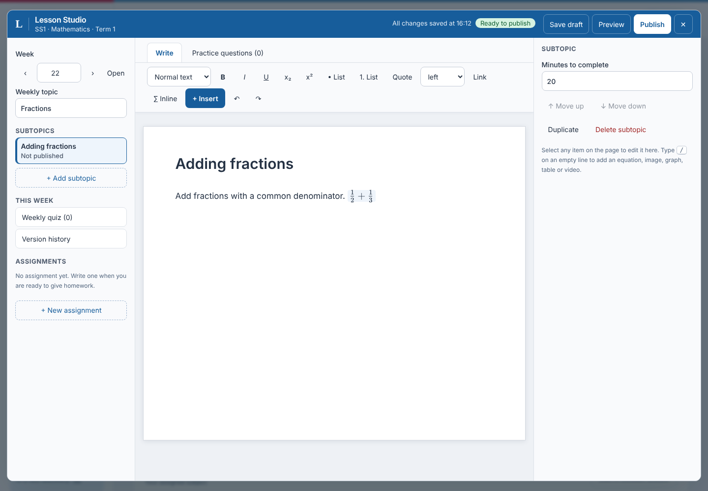
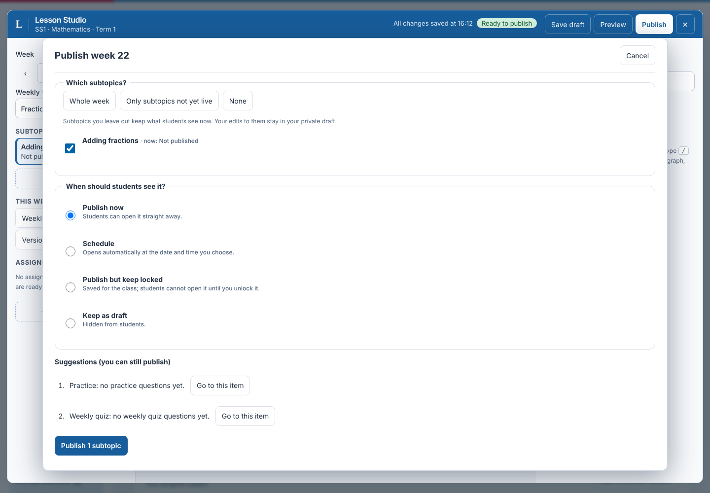
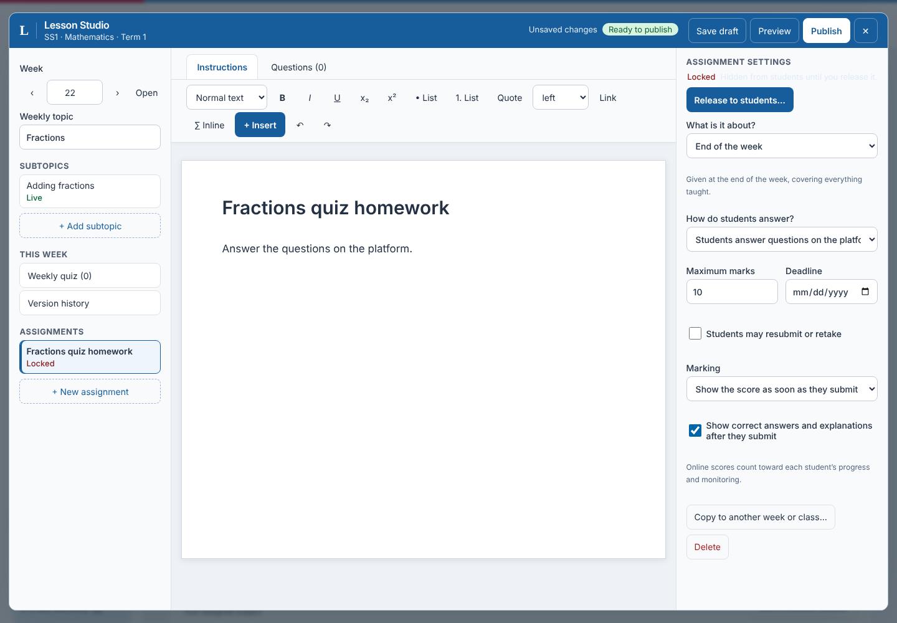
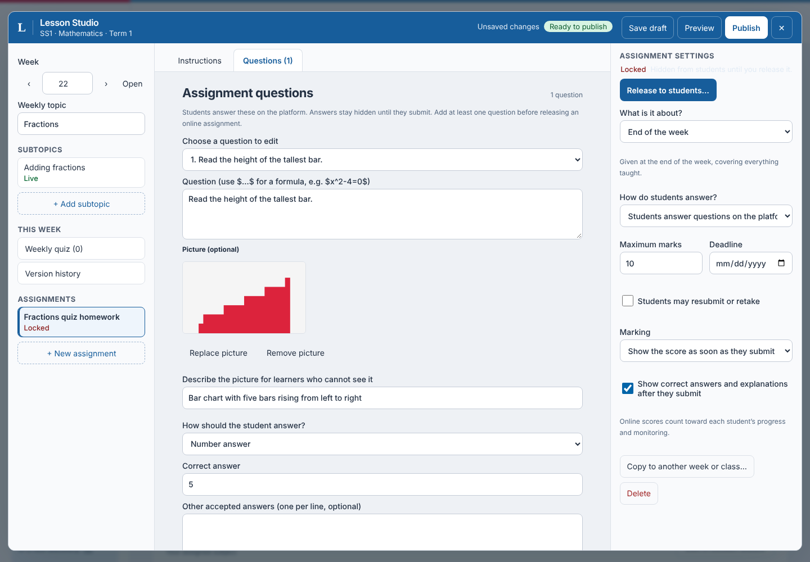

# Lesson Studio guide

Lesson Studio is the one place where teachers write weeks, lessons, practice questions, quizzes and assignments. Open it from **Teaching workspace** (Edit in Lesson Studio, or Write an assignment).

## Weeks and lessons

- A week holds one or more lessons (subtopics). Write each lesson in one continuous editor: type text, press `/` for an equation, image (alt text required), graph, table, example or video.
- Every insert leaves the caret on the next line, so you can keep typing.
- Save keeps a private draft. **Publish** opens a dialog: release now, schedule, keep locked, or leave as draft, **per lesson or per week**.
- Adding a lesson to an already published week and publishing only that lesson does not change the live text of earlier lessons.

## Questions (practice and quiz)
- Kinds: multiple choice, short answer, numeric (with tolerance), multi-part (several answers) and true/false.
- Each question has marks, difficulty, a hint and accepted alternative answers. Write maths inline as `$x^2+1$`.
- Import many questions from CSV; the Studio reports row errors before importing.
- **Pictures**: choose *Add a picture or diagram* under the question text. Alt text is required before publishing. The picture stays private to the class and reaches students only once the lesson or assignment is released. Copying an assignment copies its pictures.
- Readiness checks warn about missing answers or empty prompts; a lesson with no questions can still be published.

## Assignments
- **Link**: to one lesson, to several lessons (general) or to the end of the week.
- **Mode**: *Photo* (students photograph notebook work) or *Online* (students answer the questions in the portal).
- **Written like a lesson**: the instructions use the same editor, including equations and images.
- **Release**: new assignments are **locked**. Release them after teaching in class (now or scheduled). Release is separate from lesson release.
- **Auto-grading** (online only): *Immediately* shows the score on submit, or *After review* waits for the teacher. Scores count toward progress and monitoring.
- **Late work**: online work handed in after the due date is still marked straight away, flagged *Late*, and counted in the teacher's monitoring view (per student, next to assignments submitted).
- **Copy**: copy an assignment to any class or subject you teach; the copy starts locked.
- **Due date** is optional while an assignment is a draft or locked, and required when it is released.

The screenshots are regenerated with `npm run capture-guide-screenshots`.

## First-time school setup
1. Sign in as administrator with the temporary password and choose a new one.
2. **Add student / teacher**, then **Assign a subject** to each teacher.
3. The teacher opens Lesson Studio and creates Week 1; students see it once published.
