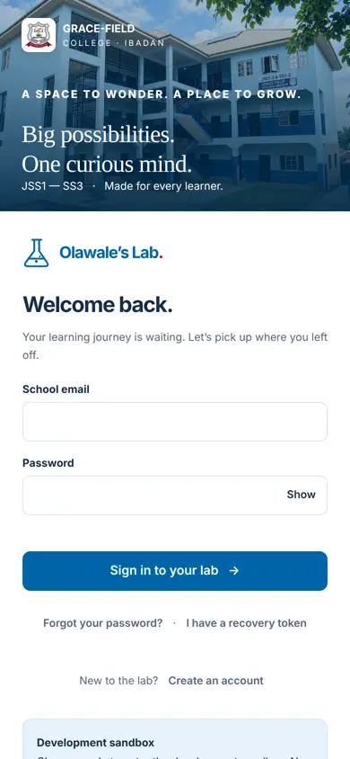
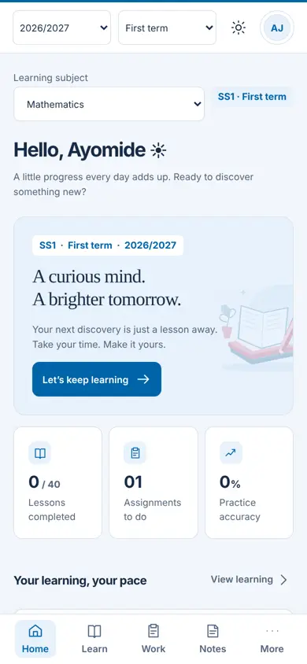
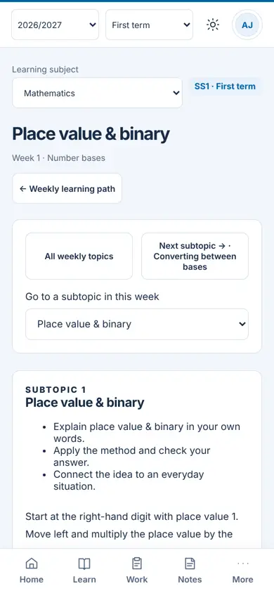
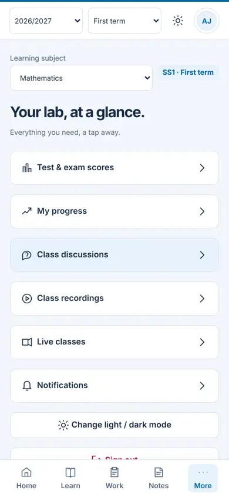
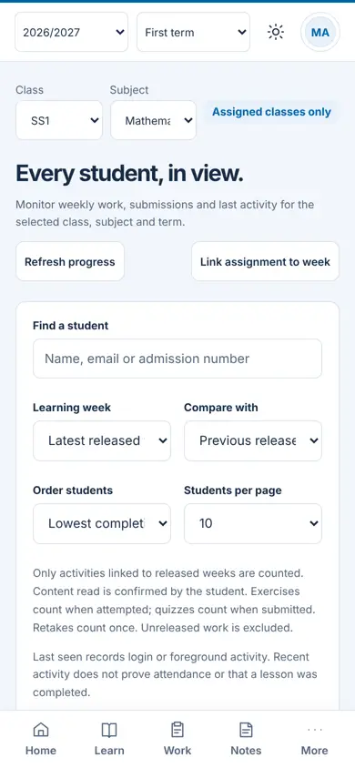
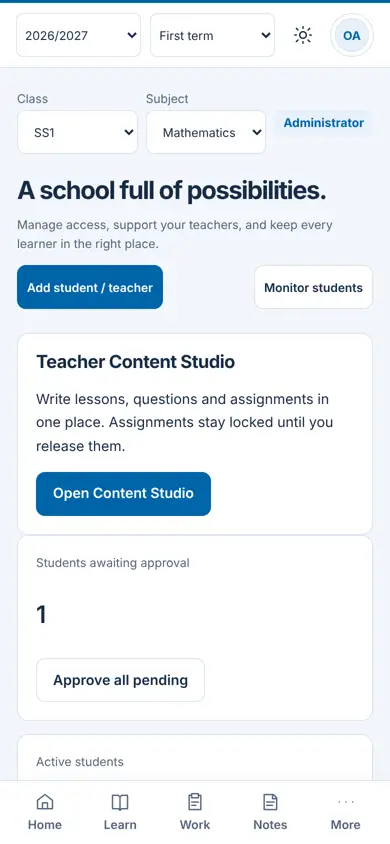

# Olawale's Lab, Version 3: audit and implementation plan

Status: proposal for review, **updated 1 November 2026 with the owner's decisions** (section 10). Nothing in this document has been implemented yet.
Audited: branch `clean-platform-v2` (PR #4), 1 November 2026.
Audience: the school owner, teachers, and whoever builds Version 3.

---

## 0. Summary

**The product is in good shape for a first release.** The lesson, assignment and monitoring features work, the phone layout already has a bottom tab bar, the screens are readable, and an automated accessibility scan found **no violations on any of the 23 screens tested** (iPhone-sized, student, teacher and admin).

**The biggest problem is data weight, and it is easy to fix.** A student who signs in and opens 12 screens downloads about **8.7 MB**. One file, the 1.3 MB school crest, is responsible for most of it. Students with little or no data will feel this immediately. After the fixes in section 2, the same session should cost **well under 0.5 MB**.

### The ten findings that matter most

| # | Finding | Evidence | Priority |
|---|---|---|---|
| 1 | The school crest (`school-logo.png`) is **1.34 MB** and is shown at about 40 px. It is downloaded again on about half of all page changes. | Measured | P0 |
| 2 | **No compression** (no gzip/brotli) and **no cache validators**; every static file is re-sent in full. | Measured and read from `server.mjs` | P0 |
| 3 | The service worker is "network first", so it never saves data. It also pre-caches the 1.3 MB crest. | Read from `public/sw.js` | P0 |
| 4 | The app is **not yet installable on iPhone** and only weakly on Android: SVG-only icon, no PNG icons, no Apple icon, mismatched theme colours. | Read from `manifest.webmanifest`, `index.html` | P0 |
| 5 | **Every role gets the same bottom tabs** (Home, Learn, Work, Notes, More). Teachers and admins need different ones. | Screenshots | P1 |
| 6 | About 150 px of the top of every phone screen is used by session, term and subject pickers, even for students who have only one choice. | Screenshots | P1 |
| 7 | The lesson page is about **17 screens long** with three navigation blocks before the first line of content. | Measured (14,344 px) | P1 |
| 8 | There is **no offline reading** and no way to download a week for later. Typed answers are not queued when the signal drops. | Read from code | P1 |
| 9 | The client is one 84 KB file of very long lines plus scripts that patch each other's functions. It is hard to change safely. | Read from code | P2 |
| 10 | Every save rebuilds and compares the **entire database** in memory. Fine for one class, a risk for a whole school. | Read from `database.mjs` | P2 |

### Decisions received (1 November 2026) and what they change

| Decision | Effect on the plan |
|---|---|
| Link or QR code is enough on day one | No app-store work. Section 7.3 updated. |
| English labels only | Yoruba labels removed from the plan. |
| **No parent accounts.** Admin and teachers see each child's progress and **download a report for parents** for a chosen time period | New section 13 (parent report). The old "parent view" item is dropped. |
| The Monitor tab must show **realistic, measurable progress**, who needs support, whether a child is grasping each topic, and how to help | New section 12 (support monitor). |
| First host on `vercel.app`, later a purchased domain | **Warning, section 11:** the app cannot run on Vercel Functions as it is built, and an installed app does not follow a change of domain. |

### What is already good (keep it)

- Friendly, consistent tone and good empty states ("A clean desk", "Your replay shelf is ready").
- Bottom tab bar on phones, skip link, `lang` set, labelled form fields, dark mode toggle.
- Photos are **compressed on the phone before upload**, and there is an **offline upload queue** for notebook photos (`queueOp`, IndexedDB).
- Security basics are present: Content-Security-Policy, CSRF tokens, scrypt password hashing, rate limiting, HttpOnly cookies, forced password change on first login.
- 107 automated tests plus browser checks for the Lesson Studio at five window sizes.

---

## 1. How the audit was done, and its limits

| Step | What was done |
|---|---|
| Phone walkthrough | Headless Chromium at **390 × 844** with touch emulation, signed in as sample student, teacher and admin. Screenshots of 23 screens. |
| Accessibility scan | axe-core (WCAG 2.0/2.1 A and AA rules) on every screen. |
| Weight | Bytes counted from the browser's network layer per screen, plus gzip/brotli size of each file, plus image conversion tests. |
| Code review | File sizes, structure, persistence code, service worker, manifest, headers. |

**Not covered, so treat as open questions:** a real low-end Android phone, real slow networks (numbers below are on a fast local connection, so *byte counts* are reliable but *timings* are not), Safari on iPhone, screen readers (TalkBack, VoiceOver), dark-mode contrast, text zoom at 200%, and the sample data being small. Automated accessibility tools catch roughly a third of real problems, so "zero violations" is a good sign, not a pass.

Screens that were reached: login, student (home, learn, lesson, assignments, notes, scores, progress, discussions, recordings, live, more), teacher (teaching workspace, students, class progress, assignments, notes, scores, learn, more), admin (school management, students, progress).








---

## 2. Data weight (the most important section for your students)

### 2.1 What a student downloads today

| Item | Size sent | Notes |
|---|---:|---|
| `school-logo.png` | **1,345,503 B** | Source image is 1254 × 1254 px; displayed about 40 px wide. |
| `school-building.jpeg` | 161,828 B | Login background. |
| `app.js` | 85,158 B | |
| `upgrade.js` | 32,822 B | |
| `style.css` | 25,567 B | |
| other scripts and styles | about 90,000 B | |
| **Opening the login page** | **about 1.74 MB** | |
| Page changes after sign-in | 11 KB (data only) **or 1.36 MB** (when the crest is fetched again) | Observed on 5 of 11 student page changes. |
| **Student session of 12 screens** | **8.67 MB** | Teacher and admin sessions: 4.5 MB. |

Why the crest comes back: static files are sent with `Cache-Control: no-cache` and **no validators** (no ETag, no Last-Modified), so the browser cannot say "I already have this" and downloads the whole file again. This is a reasoned explanation from the headers; confirm it with the fix in step 2.2.

### 2.2 Fixes, in order of payoff

| Fix | Saves | Effort |
|---|---|---|
| **Replace the crest** with a 96 px and 192 px WebP (measured: **4.7 KB** and **12 KB**). Keep a PNG fallback only for the install icon. | about 1.33 MB per visit | 1 hour |
| **Resize the login photo** to 640 px WebP (measured **45 KB**, was 162 KB), and do not load it at all in data-saver mode. | about 117 KB | 1 hour |
| **Compress text responses** with brotli (gzip fallback). Measured shell sizes: JavaScript 182 KB → about 51 KB; CSS 43 KB → about 11 KB. The student shell goes from about 225 KB to about **62 KB**. Pre-compress at build time so the server does no work per request. | about 160 KB per first visit | half a day |
| **Content-hashed file names plus `Cache-Control: public, max-age=31536000, immutable`** for scripts, styles, images and fonts; `no-cache` plus ETag for `index.html` only. | every repeat visit costs about 0 KB for the shell | half a day (needs the small build step in 5.3) |
| **Cache-first service worker** for the shell and a stale-while-revalidate rule for lesson data (see section 7). | repeat visits and offline reading | 1 day |
| **Load code by role.** Teacher-only scripts (monitoring, students, admin directory, Studio) should not be sent to students. | about 40 KB raw for students | half a day |
| **Lazy-load maths** only on lessons that contain maths (already partly done) and subset the 20 KaTeX fonts (260 KB total) to the ones used. | up to 200 KB on maths lessons | half a day |
| **Smaller data calls**: `state` is fetched in full on every page change (about 11 KB for a student, grows with class size for teachers). Return only what the screen needs and use `If-None-Match`. | 5 to 10 KB per page change | 1 to 2 days |

### 2.3 Budget to hold the line

| Measure | Today | Target |
|---|---:|---:|
| Login page, first visit | about 1.74 MB | **under 120 KB** |
| App shell after sign-in (first visit) | about 0.3 MB | **under 100 KB** |
| Any page change | 11 KB to 1.36 MB | **under 15 KB** |
| A lesson without video | 33 KB (no maths) | **under 60 KB** with maths |
| 12-screen student session | 8.67 MB | **under 0.4 MB** |

Add these as a **performance budget in CI** so they cannot creep back (section 5.5).

### 2.4 Data-saver mode (new feature)

- A "Use less data" switch in **More**, on by default when the browser reports `Save-Data` or a slow connection.
- Effects: no login photo, no decorative illustrations, no auto-loading of videos (show a "Watch (about 40 MB)" button with the size), lower-resolution lesson images, and no background refresh.
- "Download this week for offline" on each week with the size shown before the student taps ("Week 3, 1.4 MB").

---

## 3. Navigation and information architecture

### 3.1 Observed

- **One tab bar for everyone.** Students see Home, Learn, Work, Notes, More. Teachers and admins see the same five tabs, which do not match their jobs. An admin's most-used actions (approve students, add teacher, monitor) are not tabs.
- **Always-on context pickers.** Academic session, term and subject sit at the top of every screen, about 150 px on a phone, even when the student has one session and one subject. Students should never need the session picker.
- **Truncated labels** on the teacher monitoring screen: "Mathema…", "Latest released…", "Lowest completi…". Six controls and two paragraphs of explanation appear before the first student.
- **Naming drifts.** "Lesson Studio", "Teacher Content Studio", "Open Content Studio" and "weekly lesson template" all mean the same thing. "Work" in the tab bar is "Assignments" elsewhere; "Class discussions" is "Questions" elsewhere.
- **Notifications** are a row inside More, not a bell with a count.
- **Admin "Approve all pending"** approves in one tap with no review step.

### 3.2 Recommended structure

| Role | Bottom tabs (phone) | Notes |
|---|---|---|
| Student | **Today**, **Learn**, **Work**, **Progress**, **More** | "Today" shows what to do next (continue lesson, due work, new feedback), not statistics. |
| Teacher | **Today**, **Classes**, **Studio**, **Marking**, **More** | "Marking" is a queue: newest submissions first, one-tap open and mark. |
| Admin | **Overview**, **People**, **Classes**, **Monitor**, **More** | "People" holds students, teachers, approvals and imports. |

- Replace the three pickers with **one context chip** ("SS1 · Mathematics · Term 1"). Tapping it opens a bottom sheet. Hide it for a student with a single choice. Session belongs to admin settings.
- Add a **notification bell** with a count in the header.
- Use **one name per thing** everywhere (Lesson Studio, Assignments, Questions) and apply it in the UI, guide, and tests.
- Replace "Approve all pending" with a short review list (photo present, class correct) and one confirm.
- On desktop, keep the side menu; on phones keep the bottom bar. Never both.

---

## 4. Screen-by-screen findings

Severity: **High** blocks or confuses many users, **Medium** costs time, **Low** polish.

### 4.1 Sign-in
| Finding | Severity | Suggestion |
|---|---|---|
| Crest (1.3 MB) and photo (162 KB) load before the form can be used on a phone. | High | Section 2. Show the form first; load the photo after. |
| Photo takes the top 28% of the screen on a phone. | Low | Shrink to a slim band on small screens so the form shows without scrolling. |
| "Forgot your password?" and "I have a recovery token" sit close together. | Low | Separate with spacing; make recovery token a second step. |
| Two text elements below 12 px. | Medium | Raise to 12 px minimum. |

### 4.2 Student: Home
| Finding | Severity | Suggestion |
|---|---|---|
| About 150 px of pickers before the greeting. | High | Context chip (3.2). |
| Hero illustration and the large panel push the "what next" button to the middle of the screen. | Medium | Put one primary card at the top: "Continue: Place value & binary, 12 min". Keep statistics below it. |
| Three statistics ("0/40 lessons", "01 assignments", "0%") mean little on day one. | Low | Replace with a gentle streak or a "next 3 things" list. |

### 4.3 Student: Learn and Lesson
| Finding | Severity | Suggestion |
|---|---|---|
| The lesson page is **14,344 px tall**, about 17 screens. | High | Break into steps (Read, Try, Check, Reflect) with a sticky progress bar and Next/Back. Remember where the student stopped. |
| Three navigation blocks (back button, "All weekly topics / Next subtopic", subtopic picker) sit above the content. | High | One compact bar. Move the subtopic picker into the progress bar. |
| Six elements with text under 12 px. | Medium | Raise to at least 12 px; 14 px for body. |
| Long text and maths on a 390 px screen. | Medium | Verify wrapping of long equations; add horizontal scroll inside the equation, not the page. |
| No "save for later" or "download" control. | Medium | Offline pack (section 7). |

### 4.4 Student: Assignments, Notes, Scores, Progress, Discussions, Recordings, Live
| Finding | Severity | Suggestion |
|---|---|---|
| Each page change refetches data and sometimes the crest (2.1). | High | Section 2. |
| Assignments: online assignments and photo assignments look alike in the list. | Medium | Add a badge: "Answer here" or "Photograph your notebook". Show a clear locked/released/late state. |
| Notes: the 7-day strip is a good idea but has no reminder. | Low | Optional daily reminder (push, section 7). |
| Scores and Progress show numbers without a next step. | Medium | Add one line per weak area: "Practise fractions (3 questions)". |
| Discussions: all class questions in one long list. | Medium | Filter by lesson; show "Answered" status at the top. |
| Recordings and Live: list-only. | Low | Show size of each recording and "Add to calendar" for live classes. |

### 4.5 Teacher
| Finding | Severity | Suggestion |
|---|---|---|
| Teaching workspace works, but its naming differs from the Studio. | Medium | Rename to "Studio" and "Marking". |
| Monitoring: six filters and two paragraphs before the first student; truncated labels. | High | Open with "Needs attention" (late, inactive, low accuracy). Put filters in a sheet. Shorten labels. |
| Marking is reached through three different screens (notes, assignments, submissions). | High | One **Marking queue** with filters (class, assignment, status) and swipe/next navigation. |
| No bulk actions on photo marking (feedback bank, "mark all as complete"). | Medium | Add reusable comments and a "next student" button after saving. |
| Late work now shows a count in monitoring (done). No export. | Medium | CSV export of marks and submissions per class. |
| Lesson Studio: now usable on small windows (done). No autosave indicator between sessions. | Low | Show "Draft saved 2 minutes ago" on reopening. |

### 4.6 Admin
| Finding | Severity | Suggestion |
|---|---|---|
| Home mixes counts, a promotional "Open Content Studio" card and a long audit log. | Medium | Show approvals, new accounts this week, and problems (students without photo, teachers without class). |
| "Approve all pending" without review. | High | Review list with confirm (3.2). |
| Backup and restore exist only as command-line scripts. | Medium | "Download backup" button with a clear warning and last-backup date. |
| Term and session changes are spread across screens. | Medium | One "School year" page: current session, term, promotion and archive. |

---

## 5. Architecture, structure and design

### 5.1 Findings

| Area | Observation | Risk |
|---|---|---|
| **Client code** | `public/app.js` is 84 KB in 198 lines (about 430 characters per line) of template strings. Eight classic scripts share global variables. `upgrade.js` replaces `auth` and `weekly-course.js` wraps `modal` by overwriting global functions. | Hard to review, test and change; changes in one file silently break another. |
| **No client build step** | No minify, no hashed names, no code splitting; the Studio loads many small modules. | Larger downloads, weak caching. |
| **Server layout** | About 20 `.mjs` files flat in the repository root. Routes are `if(endpoint===…)` chains inside several files; validation is hand-written per route. | Easy to miss a check; hard to find where a route lives. |
| **Persistence** | The whole database sits in memory. `persist()` rebuilds every row and compares it to the previous copy **on every save**. Most data is stored as JSON in a `content` column. | Cost grows with total records, not with the change; hard to query or index (monitoring does work in JavaScript). |
| **Types** | Strict TypeScript only for grading (`core/domain.ts`); everything else is untyped JavaScript. | Mistakes found late (for example the score bug fixed in this PR). |
| **Runtime** | Needs `node --experimental-sqlite`. | Experimental flag; behaviour may change between Node releases. |
| **Tests** | 107 tests and six browser scripts pass. There is **no CI workflow** in the repository, so nothing runs them automatically. | A bad change can be merged. |
| **Repository hygiene** | Root contains stray files (`General.png`, `SS1 MATHEMATICS LESSON NOTES.pdf`, `SS1_Mathematics_Student_Masterclass.html`, `sch_building.jpeg`), several overlapping status documents, and committed `preview/` screenshots. | Confusing for new contributors; larger clones. |
| **Security (observed)** | CSP, CSRF, scrypt, rate limits, HttpOnly cookies, forced first-login change. CSP still allows inline styles. HSTS and Referrer-Policy were not checked. | Low today; plan to tighten. |

### 5.2 Target structure (keep it dependency-light)

```
src/
  server/
    app.mjs               start-up, config, HTTP server
    http/                 router, static files (brotli, ETag), security headers
    routes/               one file per area: auth, students, lessons, assignments, monitoring…
    services/             business rules (grading, release, marking) with no HTTP
    data/                 repositories + migrations (SQL)
  client/
    app/                  shell, router, store, api client
    screens/              student/, teacher/, admin/ (one module per screen)
    components/           button, card, sheet, list, empty-state
    studio/               Lesson Studio (already modular)
  shared/                 types and validators used by both sides
docs/ tests/ scripts/ public/ (build output only)
```

### 5.3 Recommendations

1. **Keep "no heavy framework".** React or Angular would add more bytes than the whole current shell. Use native ES modules with a **tiny view helper** (a 3 KB template library such as lit-html or Preact, or hand-written `html` tagged templates) so screens become small readable functions instead of 400-character lines.
2. **Add a build step** (esbuild): minify, content-hash names, split by role, emit brotli and gzip copies, generate the service-worker file list. This single step delivers most of section 2.
3. **Replace monkey-patching** with explicit extension points (`registerScreen`, `registerModalHook`). Remove `upgrade.js` by folding it into the modules it patches.
4. **Router table on the server**: `route('POST','/assignment-save', {role:'teacher', body:schema, handler})`. Centralises role checks, CSRF, rate limits and validation so a new route cannot forget them. This is also where the safe-field projection for students (the leak fixed in this PR) belongs.
5. **Incremental persistence**: mark records dirty when they change and write only those; keep the full in-memory copy for reads at first. Move hot queries (monitoring, marking queue) to real columns with indexes. Keep PostgreSQL optional for a school-wide rollout.
6. **Types without a rewrite**: add `// @ts-check` and JSDoc types file by file, starting with routes and services; keep strict TypeScript for `core/`.
7. **CI**: a GitHub Actions workflow that runs `npm run build`, `npm test`, `npm run verify-math`, the browser scripts under `xvfb`, and **size budgets** (fail if the shell exceeds 100 KB brotli or any page change exceeds 15 KB).
8. **Pin Node** in a Dockerfile and `.nvmrc`; run a scheduled check against the next Node release for the SQLite API.
9. **Tidy the repository**: move stray files to `docs/archive/` or delete; merge the overlapping status documents into one `docs/STATUS.md`; keep `docs/images/` only.
10. **Observability**: structured logs, a `/healthz` endpoint, and an error counter on the client (no personal data).

---

## 6. Accessibility

### 6.1 Result

| Check | Result |
|---|---|
| axe-core WCAG 2.0/2.1 A and AA, 23 screens at 390 px | **0 violations** |
| Lesson Studio, 5 window sizes (keyboard, drawers, menus) | Passes |
| Horizontal scrolling at 360 and 390 px | None on the screens tested |
| Skip link, `lang`, labels | Present |
| Tap targets under 40 px | 1 per screen (not yet identified) |
| Text under 12 px | Login 2, lesson 6, class progress 7, admin 2 |

### 6.2 To do (manual testing is required)

| Item | How |
|---|---|
| Screen reader pass on student journey (sign in, open lesson, answer, submit) | TalkBack on Android and VoiceOver on iPhone, by a real tester. |
| Dark-mode contrast | Run the axe scan again with dark mode on. |
| Zoom 200% and larger text | Browser zoom and system font size at maximum; nothing may be cut off. |
| `<dialog>` modals | Confirm focus moves in, is trapped, and returns on close; confirm Esc closes. |
| Live announcements | The app has only two live regions. Announce "Saved", "Submitted", "Marked", errors and offline/online changes. |
| Form errors | Tie each error to its field (`aria-describedby`), move focus to the first error. |
| Touch target size | Make every control at least 44 × 44 px. |
| Reduced motion | A global rule exists; check animations in the lesson widgets. |
| Language and reading level | Short sentences and plain English labels (English only, decided 1 Nov 2026). |
| Maths | Equations need readable text (the editor stores alt text; verify the student view announces it). |

---

## 7. Installable app and offline use

### 7.1 What exists

`manifest.webmanifest` has a name, `standalone` display and an SVG icon. `sw.js` registers and pre-caches about 25 files, but uses network-first for everything, so it only helps when the user is already offline and the shell was cached.

Problems found:
- Icon is **SVG only**. Android and Chrome's install rules and iPhone's Home Screen need **PNG** icons (192 and 512 px, plus a maskable 512 and a 180 px Apple touch icon). None exist.
- **Theme colour mismatch**: `<meta name="theme-color">` is `#006bb5`; the manifest says `#0064a8`.
- No `id`, `scope`, `shortcuts`, `screenshots`, `categories` or `lang` in the manifest.
- No install prompt, update prompt, or offline banner.
- The 1.3 MB crest is in the pre-cache list.

### 7.2 Plan: three steps, each useful on its own

**Step A: Installable web app (no app store).** Students open the school link, tap "Add to Home Screen" and get an icon and full-screen app.
1. Complete the manifest (`id`, `scope`, `start_url:"/?source=pwa"`, `categories:["education"]`, `lang`, shortcuts for "Continue learning" and "Assignments", matching theme and background colours).
2. Create PNG icons (192, 512, maskable 512, Apple 180) from the crest, and add `<link rel="apple-touch-icon">`.
3. Add an **Install** button: on Android use `beforeinstallprompt`; on iPhone show a short "Tap Share, then Add to Home Screen" sheet. Offer it after the second visit or first successful sign-in, never on the login page.
4. Add an **update toast** ("New version ready. Refresh") and a **offline banner**.
5. Must be served over **HTTPS**; a reverse proxy such as Caddy or Cloudflare also gives brotli and HTTP/2 or HTTP/3 for free.

**Step B: Works with poor or no signal.**
- Service worker: **cache-first** for the hashed app shell; **stale-while-revalidate** for lesson JSON and images, with a size cap (for example 30 MB) and automatic clean-up of old weeks.
- **"Download this week"** button that fetches the week's lessons, images and quizzes into the cache and shows the size first.
- **Outbox**: answers, reflections and assignment submissions typed offline are saved in IndexedDB and sent when the connection returns (Background Sync where supported, otherwise on the `online` event). The app already does this for notebook photos; extend it to every write. Show "Waiting to send (2)" and never lose work.
- Server must accept **idempotent retries** (a request ID, so a repeated send is not counted twice).
- Never cache the signed-in `state` or any private API response in a shared cache; scope caches by user and delete them on sign-out.

**Step C: Re-engage with Web Push (optional).** Opt-in notifications for "Assignment released", "Feedback ready", "Live class starts in 10 minutes". Free (VAPID keys), tiny payloads. On iPhone push works only after the app is added to the Home Screen (iOS 16.4 or newer).

### 7.3 Distribution options

| Option | Cost to students | Cost to school | Good for | Caveats |
|---|---|---|---|---|
| **Link or QR code** to the web app, then "Add to Home Screen" | None | None | Everyone, fastest | Needs a short instruction card; iPhone users must use Safari. |
| **Google Play** via a Trusted Web Activity (Bubblewrap or PWABuilder) | None | One-time Play developer fee | Android families who expect an app in the store | Needs a domain, HTTPS, and an `assetlinks.json` file; updates still come from the website. |
| **App Store** (Capacitor wrapper) | None | Annual Apple developer fee, review effort | Only if the school wants an iOS store listing | Apple rejects thin website wrappers; not recommended for version 3. |
| **Native rewrite** | None | Large | Not needed | Duplicates work; camera, files, push and offline are all possible on the web. |

**Decision (1 Nov 2026):** a link and QR code are enough on day one. Ship **Step A, then Step B**, print a **QR code** poster with a one-line install card, and skip the store listings. A Play Store listing can be added later without rebuilding anything.

### 7.4 What would change in the build
- A generated `sw.js` with the hashed file list and cache versions.
- `public/manifest.webmanifest` and `public/assets/icons/*`.
- A small `install.js` module and `offline-queue.js` (generalising `queueOp`).
- Server: `Idempotency-Key` support on write endpoints, ETag and 304 on `GET`, and a `/healthz`.

---

## 8. New and improved functionality (ranked)

| # | Feature | Why | Size |
|---|---|---|---|
| 1 | Data-saver mode and "download this week" | Students with little data | M |
| 2 | Marking queue with reusable comments and next-student flow | Teachers lose time moving between screens | M |
| 3 | Notification bell and optional push | Students miss released work and feedback | M |
| 4 | "Today" screen: what to do next | Reduces choice paralysis for students | S |
| 5 | CSV export (marks, submissions, late work) and printable class report | Teachers and school records | S |
| 6 | Admin "School year" page: session, term, promotion, archive; one-click backup | Removes command-line steps | M |
| 7 | Question bank sharing between classes and subjects; assignment templates | Saves teacher time | M |
| 8 | Weak-area suggestions on Progress ("Practise fractions") | Turns numbers into action | M |
| 9 | Calendar view of due dates and live classes, with add-to-calendar | Planning | S |
| 10 | Photo marking tools (zoom, simple pen markup, comment on a spot) | Notebook marking is the core photo workflow | L |
| 11 | ~~Parent or guardian accounts~~ **Not wanted.** Replaced by the downloadable parent report (section 13) | Owner decision | n/a |
| 12 | Plain-language wording check for the English labels | Reading ease | S |

---

## 9. Version 3 roadmap

Estimates are working days for one developer and include tests.

| Phase | Goal | Contents | Days | Done when |
|---|---|---|---:|---|
| **V3.0 Quick wins** | Cut data use now | Crest and photo conversion; brotli/gzip; ETag/304; cache headers; fix theme colour; PNG and Apple icons; remove crest from pre-cache | 2 | 12-screen student session under 1 MB |
| **V3.1 Build step and PWA shell** | Installable, fast on repeat | esbuild bundle (role-split, hashed, pre-compressed); new service worker; complete manifest; install and update prompts; offline banner | 5 | Lighthouse PWA checks pass; repeat visit under 20 KB |
| **V3.0h Hosting** | Run it somewhere safe | Section 11: long-running host, managed Postgres, object storage, HTTPS, backups, health check | 2 | Staging site live; backup and restore rehearsed |
| **V3.2 Navigation and layout** | Easy to use | Role-specific tabs; context chip; notification bell; consistent names; lesson steps with progress; teacher "Needs attention" and Marking queue; admin review-before-approve | 8 | Walkthrough tests pass at 390 px for all roles |
| **V3.2m Support monitor** | Know who needs help and why | Section 12: evidence model, support flags, class board, student profile, support plans | 16 | Flagged list agrees with teachers' own list on 80% or more of a pilot class |
| **V3.2r Parent report** | Reports for parents | Section 13: report builder, editable comments, print and PDF, class bulk run, audit | 8 | A full class of reports generated, reviewed and downloaded in under 10 minutes |
| **V3.3 Offline and data saver** | Works with little data | Download-week; stale-while-revalidate lessons; outbox with idempotent retries; data-saver switch; smaller `state` calls | 8 | Student can read and answer a downloaded week in airplane mode; no answer lost |
| **V3.4 Architecture** | Safe to grow | Router table with schema validation; split `app.js` into screen modules; remove monkey-patching; CI with budgets; repository tidy; Node pinning | 10 | CI green; no file over 400 lines; budgets enforced |
| **V3.5 Data layer** | School-wide scale | Incremental persistence; indexed columns for monitoring and marking; load test with 1,000 students | 6 | Save time independent of database size; monitoring page under 300 ms |
| **V3.6 Accessibility and polish** | Inclusive | Manual TalkBack and VoiceOver passes; dark-mode and zoom checks; live announcements; 44 px targets; text size floor | 5 | Written test report; zero known blockers |
| **V3.7 Optional extras** | Re-engagement | Web Push; calendar; CSV export; weak-area suggestions; Play Store listing via TWA | 8 | Per feature |

Total core (V3.0 to V3.6 plus hosting, support monitor and parent report): about **70 working days**. V3.0, V3.0h and V3.1 (9 days) deliver a small, fast, installable app on real hosting. The support monitor and parent report (24 days) are what teachers and parents will notice most.

### Quality gates for every phase
- `npm run build`, `npm test`, `npm run verify-math`, and all browser scripts pass.
- Accessibility scan at 360, 390, 768 and 1280 px: zero violations.
- Size budgets (2.3) pass.
- A written manual test list for the changed screens.

---

## 10. Decisions and open questions

### Decided by the owner (1 November 2026)
1. Day one is a **link and QR code**, no store listing.
2. **English only.**
3. **No parent logins.** Staff download a parent report for a chosen period (section 13) and the Monitor is rebuilt around measurable support (section 12).
4. First host: **vercel.app** (or another supported host), later a **purchased domain** (see the warnings in section 11).

### Confirmed by the owner (1 November 2026)
5. **All-subject view:** admin and a form teacher assigned per class. Subject teachers see their own subject only.
6. **Class position:** not shown on the report (can be switched on later per school).
7. **Marks:** show test and exam marks as entered, with the four support bands. No separate grade scale or CA weighting yet.
8. **Signatures:** class teacher and head teacher lines.

### Still open
| Question | Note |
|---|---|
| Who buys the domain, and when? | Decide **before** students install the app or QR posters are printed (section 11.3). Until then, use the temporary address for staff testing only. |

---|---|
| Who may see **all subjects** for one child (needed for the combined report)? | Admin and a **form teacher** assigned per class. Subject teachers see their own subject only. |
| Should the report show **class position**? | **No** (shows band and trend only). Can be switched on per school. |
| Does the school use a **grade scale** (A1 to F9, percentages) and **CA/exam weights** for the "scores so far" line? | Use the existing test and exam scores as entered, shown as marks and percentages, with the four support bands from section 12. |
| Who **signs** the report (class teacher, head teacher)? | A configurable signature line for class teacher and head teacher. |
| Who **buys the domain** and when? | Decide **before** parents and students install the app (see section 11.3). |

---

## 11. Hosting plan (read this before choosing vercel.app)

### 11.1 The problem
Vercel runs your code as short-lived **functions**. Vercel's documentation says each function has a **read-only filesystem with a temporary `/tmp` scratch area** ([Vercel runtimes](https://vercel.com/docs/functions/runtimes)). Olawale's Lab is built differently:

| How the app works today | Why it fails on Vercel Functions |
|---|---|
| One long-running Node server (`http.createServer` and `listen`) that handles one request at a time | Functions start and stop per request; many copies can run at once. |
| The **whole database is held in memory** and written back on each save | Two copies would each hold a different version, so one student's save could overwrite another's. |
| SQLite file and uploaded files stored on local disk | Disk is read-only or temporary and is lost between runs. |
| Rate limits and upload tokens kept in server memory | Each copy has its own memory, so limits and tokens stop working. |

So pointing `vercel.app` at the current server would appear to work in a quick test and then **lose or overwrite student work**. This is the most serious risk raised by the hosting decision.

### 11.2 Options

| Option | What it takes | Verdict |
|---|---|---|
| **A. Long-running Node host first** (a service that runs a normal always-on Node process, with managed PostgreSQL and S3-compatible file storage; examples: Render, Railway, Fly.io, or a small VPS) | Configuration only: the app already supports `DATABASE_URL` for PostgreSQL and `STORAGE_DRIVER=s3` for files. One instance, HTTPS, nightly backups. About **2 days** (V3.0h). | **Recommended for launch.** Safe with the current design. Check each provider's current free-tier limits: some free services sleep when idle, which makes the first request slow. |
| **B. Vercel with a rewrite** | Stateless request handling, no whole-database cache, per-request database reads, shared rate limiting (for example a Redis service), object storage for files. This is the V3.5 data-layer work, about **6 to 10 days**, plus testing. | Possible later. Not worth doing only to use one host. |
| **C. Vercel for the pages, another host for the API** | Two origins; the session cookie is `SameSite=Strict`, so sign-in breaks across origins unless the design changes. | **Not recommended.** |
| **D. Vercel container option** | Vercel's documentation lists a container runtime and background "Daemons". Their limits and costs for a stateful school app were not verified in this audit. | Worth a short trial **only if** you must stay on Vercel. Verify state, storage and pricing first. |

### 11.3 The domain change matters more than the host
An installed web app, its saved data (sign-in cookie, offline lessons, queued answers) and its service worker belong to **one web address**. If the first address is `something.vercel.app` and the school later buys `school.example`:
- Everyone who installed the old address **keeps the old app**. It does not follow the move.
- Students would have to reinstall, and any lessons saved for offline use would need to be downloaded again.

What to do:
1. **Buy the domain before the public launch** (a domain is a small yearly cost) and use the `vercel.app` or host-provided address only for staff testing.
2. If you must start on a temporary address, tell staff it is a pilot, do **not** print QR codes yet, and plan the move for a school break.
3. When you move, put a "We have moved" notice and automatic redirect on the old address and re-issue the QR poster.

### 11.4 Hosting checklist (V3.0h)
- HTTPS and a custom domain; HTTP/2 or HTTP/3; brotli at the edge or in the app.
- PostgreSQL with daily backups and a tested restore; S3-compatible private bucket for files (versioned).
- Environment: `NODE_ENV=production`, `SESSION_SECRET` (32 or more characters), `ADMIN_EMAIL` and `ADMIN_PASSWORD`, `DATABASE_URL`, `DATABASE_SSL=true`, `STORAGE_DRIVER=s3` and the bucket settings (all described in `DEPLOYMENT.md`).
- **One instance only** until the data layer is rewritten (V3.5).
- `/healthz` endpoint and an uptime monitor; error alerts by email.
- Secrets only in the host's settings, never in the repository.

---

## 12. Student support monitor (rebuilding the Monitor tab)

### 12.1 What is wrong with the current Monitor
It counts **activity** (lessons marked read, exercises attempted, quizzes submitted) and shows percentages of work done. It answers "who has done the work?" but not **"does this child understand the topic, and what help do they need?"** A child can attempt everything and understand nothing, or do little but master it. The teacher currently has to open each student to find out. Staff also see six filters and long explanations before the first student.

### 12.2 Design principles
1. **Understanding and engagement are measured separately.** A child who did not do the work needs a different response from one who did it and got it wrong.
2. **Every number shows its evidence** ("62% from 14 answers and 1 quiz"). A score from 2 answers must not look like a score from 40.
3. **Not enough evidence is a status, not a zero.** Grey "no evidence yet" prevents false alarms in week 1.
4. **Every flag explains itself and suggests an action** a teacher can take that day.
5. **Measurable follow-up:** a support plan sets a target, and the system reports whether the child met it.
6. **Thresholds are visible and adjustable by the admin**, and the rules are documented in the app ("How we calculate this").

### 12.3 The measures (all computed from data the app already stores)

| Measure | Definition (default) | Source |
|---|---|---|
| **Understanding score** per topic (one week's topic), 0 to 100 | Weighted average of the evidence that exists: practice accuracy **on the first try** 30%, quizzes and weekly quiz (best of the latest two attempts) 40%, assignment marks 30%. If a source is missing its weight is shared among the others. | practice attempts, assessment attempts, online and photo assignment marks |
| **Evidence count** | Number of answers plus assessments plus marked assignments behind the score. | same |
| **Evidence status** | **Enough** at 8 or more answers or at least 1 assessment; **Thin** below that; **None** at 0. Thin and None are never shown as "weak". | same |
| **Band** | Mastered 85 or more; Proficient 70 to 84; Developing 50 to 69; **Needs support** below 50 (the existing school policy, editable by admin). | `masteryBand` in `core/domain.ts` |
| **Trend** | Last two topics against the two before: Improving (up 10 or more), Steady, Slipping (down 10 or more). Needs enough evidence in both. | derived |
| **Engagement score** | Share of released work completed: lessons read, exercises attempted, assignments submitted, quizzes taken, all weighted equally. | existing monitoring |
| **Timeliness** | Late submissions in the last four assignments. | the `late` flag added in this release |
| **Persistence** | Average tries before a correct answer, to spot guessing. | practice attempts |
| **Confidence gap** | The child's own confidence rating (1 to 5, from reflections) against their score. | reflections |
| **Help requests** | Unanswered questions the child asked and "difficult part" text in reflections. | discussions, reflections |
| **Active days** | Days in the period with sign-in or foreground activity (presented as "active days", **not** attendance, matching the existing disclaimer). | presence |

### 12.4 Support flags (rules, each with a reason and a suggested action)

| Flag | Rule (default) | Suggested action shown to the teacher |
|---|---|---|
| **Struggling with a topic** | Understanding below 50 with enough evidence | Reteach in small group; assign the 5 easiest missed questions again |
| **Slipping** | Down 15 or more points against the previous topic | Check in; look for a missed lesson or a skipped prerequisite |
| **Behind** | A released week with no activity after 5 days | Remind; check access (data, phone) |
| **Guessing** | Averages 3 or more tries before correct on 5 or more questions | Ask them to explain a worked example aloud |
| **Overconfident** | Confidence 4 or 5 with a score under 50 | Short diagnostic quiz and private feedback |
| **Asked for help** | Unanswered question or "difficult part" not yet addressed | Reply in the discussion or in person |
| **Late pattern** | 2 or more of the last 4 assignments late | Talk about workload and reminders |
| **Inactive** | No activity for 7 days | Contact the family through the school |
| **Missing work** | Fewer than 60% of released assignments submitted | Agree a catch-up plan |

**Overall status** from the flags and bands: **Needs support now** (any severe flag: Struggling, Slipping with a weak band, or Inactive), **Watch** (one or more lighter flags), **On track**, **Excelling** (Mastered in most topics with good engagement), or **No evidence yet**. The student card shows the **top three reasons** and the numbers behind them.

### 12.5 Screens

**1. Support board (opens by default).**
- Top strip: counts for **Needs support now · Watch · On track · Excelling · No evidence yet**, each tappable as a filter.
- The list is sorted by priority. Each row shows photo or initials, name, status, **top reason chips** ("Fractions 41%, 3 late") and a trend arrow. One tap opens the profile.
- **Topics to reteach** panel: topics where the class average is below 60 or more than a third of the class is in Needs support, with the **most commonly chosen wrong answer** for the three most missed questions (the wrong response is stored with each attempt). This shows *how* they are confused, not just that they are.
- **Heatmap** toggle: students down, topics across, colour = band, a small dot where evidence is thin.
- Period selector (this week, last 2 weeks, term, custom dates) and class/subject chips. Everything else is behind "Filters".

**2. Student profile.**
- Header: name, class, overall status, and **Create report** and **Start support plan** buttons.
- **Topic table:** understanding score, band, evidence count, trend, confidence, last practised.
- **Strengths** (top three topics at 70 or more) and **Needs help** (bottom three with enough evidence), each with the questions that were missed and the child's wrong answers.
- **Timeline:** weekly sparkline of understanding and engagement.
- **Work:** assignments with status, score, late flag; reflections and questions asked.
- **Support plans:** open and past, with progress against target.

**3. Support plan.**
- Fields: topic, action (reteach, extra practice set, pair with a peer, one-to-one, family contact), start date, **target** (for example "reach 70 in Fractions within 14 days"), owner, notes.
- The system re-measures on the due date and records **Met / Partly / Not met** with the before and after scores. This is the measurable loop the owner asked for.

**4. "How we calculate this"** page (staff only): the formulas above with the current thresholds.

### 12.6 What must be added to the data
- Tag every question with a **topic and objective** (the `objective` field exists on questions; make it required in the Studio readiness checks so scores can be grouped).
- Store a **time** with every assessment answer (practice attempts already have one).
- Add `form_teacher` on classes, `support_plans`, and an `indicator_settings` record for thresholds.
- A nightly job (or on-demand compute with caching) that produces a per-student, per-topic summary so the board loads in under a second.
- Cross-subject view for admin and form teachers; subject teachers stay limited to their subject.

### 12.7 How to prove it is realistic
1. **Pilot one class for a term.** Before showing flags, ask each teacher to list the children they think need support.
2. Compare: the share of the teachers' children that the board flags (target 80% or more), and the share of flagged children the teacher agrees with (target 70% or more).
3. Review every disagreement with the teacher, adjust the thresholds, and record why.
4. Add **fixtures and unit tests** for each formula (a child who guesses, a child who did nothing, a child with two answers) so the rules cannot drift.
5. Show a "Data confidence" note whenever evidence is thin.

---

## 13. Parent progress report (download only)

### 13.1 Who, what, when
- **Who:** the admin and the child's form teacher can produce a combined report; a subject teacher can produce the section for their own subject.
- **When:** any period ("from" and "to" dates), a term, or the session so far.
- **Output:** a one-click **PDF** (A4) and a print view; one child, or the **whole class at once** (one combined file or one file per child).
- **No parent accounts.** Staff send the file by the school's usual channel.

### 13.2 Contents (one to two pages per child)

| Block | Contents |
|---|---|
| **Header** | School logo and name, motto, "Progress report", period, date generated |
| **Child** | Name, admission number, class, academic session, term, optional photo |
| **At a glance** | Overall understanding band and score, engagement, assignments submitted and late, active days, trend arrow, test and exam scores so far |
| **Subjects table** | One row per subject: teacher, understanding score and band, engagement, assignments (submitted and late), test and exam marks, trend |
| **Per-subject analysis** | **Strengths** (topics at 70 or more) and **Weaknesses** (topics below 50 with enough evidence), each with the evidence behind it, and a **how to help** line |
| **Overall comment** | A draft from the data, edited by the teacher, covering effort, understanding, behaviour in the app and next steps |
| **Home suggestions** | Two or three specific, realistic suggestions ("10 minutes on fractions, three evenings a week") |
| **Signatures** | Class teacher and head teacher lines |
| **Footer** | How scores are calculated (one sentence), confidentiality line, page numbers, "Generated by Olawale's Lab" |

Sample layout (not final design):

```
+------------------------------------------------------------------+
| [LOGO]  GRACE-FIELD COLLEGE, IBADAN        PROGRESS REPORT       |
|         Raising young minds for future impact                    |
|------------------------------------------------------------------|
| Name: Ayomide Johnson      Admission: GF/2026/001   Class: SS1   |
| Session: 2026/2027         Term: First term                      |
| Period: 14 Sep 2026 to 31 Oct 2026      Generated: 1 Nov 2026    |
|------------------------------------------------------------------|
| AT A GLANCE   Understanding 68% (Developing, improving)          |
|               Engagement 91%   Assignments 5/6 (1 late)         |
|------------------------------------------------------------------|
| Subject      Understanding  Band         Engagement  Trend       |
| Mathematics  68%            Developing   91%         up          |
| English      81%            Proficient   88%         steady      |
|------------------------------------------------------------------|
| MATHEMATICS                                                      |
|  Strengths : Number bases (88%), Indices (74%)                   |
|  Needs help: Fractions (41%, 14 answers) - mixes up denominators |
|  How to help: 10 minutes of fraction practice, 3 evenings a week |
|------------------------------------------------------------------|
| OVERALL COMMENT (editable)                                       |
|  Ayomide works steadily and is improving...                      |
|------------------------------------------------------------------|
| Class teacher ______________   Head teacher ______________       |
+------------------------------------------------------------------+
```

### 13.3 How comments are produced
- **Rule-based sentences** built from the measures in 12.3 (for example: "[Name] is **Developing** in Mathematics (68%) and **improving** from 59% earlier this term. Strongest topic: Number bases. Needs more practice on Fractions, where common errors were mixing denominators.").
- Every sentence is backed by a number that appears in the report. No invented praise or criticism.
- The teacher **reviews and edits** every comment before release. Edits are saved with the report.
- A child with thin evidence gets "Not enough work yet to judge understanding in [topic]" rather than a weak label.

### 13.4 Workflow and safeguards
1. **Draft** (system creates), **Reviewed** (teacher edits), **Released** (admin or form teacher approves and downloads).
2. Each released report is saved as an **immutable snapshot** (the numbers and comments as they were), with who created, edited and downloaded it and when. This lets the school answer "what did we tell the parents in October?"
3. Access limited to admin, the form teacher and the subject teacher for their own section. Downloads are logged. **No public links.**
4. The PDF is small (target under 200 KB, system fonts only) so it can be shared on a phone with little data. On phones the **Share** button offers the file to other apps through the browser's share feature.

### 13.5 How it is built
- A report page with an A4 print stylesheet is the first version (no server work, works offline, easy to review).
- Server PDF generation (a small PDF library) is added in the same phase so the file can be saved and shared directly.
- Data comes from the same measures as the Support board, so the report and the Monitor can never disagree.
- New tables: `report_snapshots` (child, period, JSON of figures, comments, status, audit fields) and the school's report settings (name, logo, signatures, bands).

### 13.6 Acceptance
- A teacher can produce, edit and download a full class of reports in under 10 minutes.
- Numbers in the report match the Monitor for the same child and period (automated test).
- Every comment sentence maps to a stored measure (automated test).
- The PDF opens correctly on Android, iPhone and desktop, prints cleanly on A4, and stays under 200 KB.

---

## Appendix A: measurements

Method ("12 screens" means the login page plus 11 signed-in screens): headless Chromium, 390 × 844, touch, device scale 2, no service worker, sample school data, local server (so byte counts are accurate and timings are not).

| Screen | Data bytes | Note |
|---|---:|---|
| Login (cold) | about 1.74 MB | crest 1,345,503; photo 161,828; scripts and styles about 0.23 MB |
| After sign-in | 12,766 | data only |
| Student home | 11,325 | |
| Learn | 13,188 | |
| Lesson | 32,729 | demo lesson without maths |
| Assignments, Notes, Scores, Recordings | 1,356,439 each | crest downloaded again |
| Progress | 1,358,955 | crest downloaded again |
| Discussions, Live, More | 10,936 each | |
| **Student total (12 screens)** | **8,673,468** | |
| Teacher total | 4,588,549 | |
| Admin total | 4,536,145 | |

Compressed sizes (brotli, measured): `app.js` 23.6 KB, `upgrade.js` 9.3 KB, `style.css` 5.7 KB, `math-render.js` 63.8 KB, KaTeX CSS 2.9 KB, crest 1,148 KB (PNG does not compress), 192 px WebP crest 12 KB, 96 px WebP crest 4.7 KB, 640 px WebP photo 45 KB.

Teacher-only code never needed by students: `lesson-editor.js` 400 KB, `studio-editor.js` 393 KB, `math-input.js` 832 KB (loaded only inside the Studio).

Accessibility counts per screen (390 px): axe violations 0 on all 23 screens; controls under 40 px: 1 on each; text under 12 px: login 2, student home 1, lesson 6, class progress 7, admin 2.

## Appendix B: how to repeat the audit

1. `DEMO_MODE=true node --experimental-sqlite server.mjs` with a fresh `DATA_DIR`.
2. Use Playwright with Chromium at 390 × 844, record bytes with the Chrome DevTools Protocol (`Network.loadingFinished`), and run `axe-core` on each screen.
3. Add the script to the repository as `scripts/audit-mobile.mjs` and run it in CI so the numbers in section 2.3 are checked on every change.
